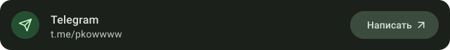

<!-- BANNER:START -->

<!-- BANNER:END -->

<!-- REPOS:START -->

<!-- REPOS:END -->

<!-- STATS:START -->

<!-- STATS:END -->

<!-- LINKS:START -->

<picture><source media="(prefers-color-scheme: dark)" srcset="https://raw.githubusercontent.com/Pivozavr7/Pivozavr7/output/github-contribution-grid-snake-dark.svg"></picture>
<!-- LINKS:END -->

