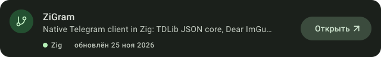

<!-- BANNER:START -->

<!-- BANNER:END -->

<!-- REPOS:START -->

<!-- REPOS:END -->

<!-- STATS:START -->

<!-- STATS:END -->

<!-- SNAKE:START -->
<picture>
  <source media="(prefers-color-scheme: dark)" srcset="assets/github-contribution-grid-snake-dark.svg">
  <source media="(prefers-color-scheme: light)" srcset="assets/github-contribution-grid-snake.svg">
  
</picture>
<!-- SNAKE:END -->

<!-- LINKS:START -->

<!-- LINKS:END -->

